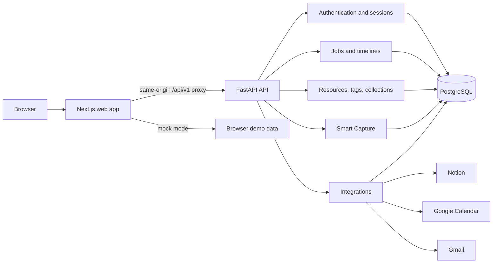

<p align="center">
  
</p>

<h1 align="center">Nuse</h1>
<p align="center"><strong>A home for the opportunities you find and the things you learn.</strong></p>

<p align="center">
  
</p>
<p align="center"><sub>Built for the Meta Global AI Developer Hackathon; selected to participate from a field of 20,000 people.</sub></p>

Students and job seekers often collect useful links everywhere: job boards,
course pages, articles, tools, and messages. Later, the links are scattered
across browser tabs, notes, and bookmarks. Job applications are just as hard to
follow when deadlines, interviews, and next steps live in different places.

**Nuse brings those opportunities and resources into one private, searchable
workspace.** Capture a URL or text, review the extracted details, and decide
what to save. Track each job through its stages, keep a timeline of next steps,
and organize learning resources with tags and collections.

## What Nuse includes

- **Jobs:** list and board views, search and filters, application stages,
  follow-ups, and a per-job event timeline.
- **Resources:** a library for courses, tools, articles, research,
  certifications, and other useful finds.
- **Smart Capture:** extract a draft from a URL or pasted text, inspect field
  provenance, edit it, and save only after review.
- **Integrations:** optional Notion resource export, Google Calendar events
  created only when requested, and Gmail read-only application updates.
- **Accounts:** username and six-digit PIN authentication with server-side
  sessions and per-user data isolation.
- **Mock mode:** explore the frontend without an API or database.

## Architecture



The web app proxies API requests through its own origin so session cookies stay
first-party. The API owns validation, authentication, authorization, and
database access. Personal records are scoped to the signed-in user; integration
credentials are encrypted at rest.

## Run locally

### Frontend preview (mock mode)

Requirements: Node.js 20.9 or newer and pnpm.

```powershell
Set-Location apps\web
Copy-Item .env.example .env.local
pnpm install --frozen-lockfile
pnpm dev
```

Open [http://localhost:3000](http://localhost:3000). Mock mode is the default
and does not require PostgreSQL.

### Full stack

Requirements: Python 3.12 or newer, [uv](https://docs.astral.sh/uv/), and a
PostgreSQL database. Any compatible PostgreSQL provider can be used.

1. Copy `apps\api\.env.example` to `apps\api\.env`.
2. Set `DATABASE_URL`, `SESSION_SECRET`, `PIN_PEPPER`, and
   `INTEGRATION_ENCRYPTION_KEY`. Keep secrets out of Git.
3. Install and migrate the API:

   ```powershell
   Set-Location apps\api
   uv sync
   uv run alembic upgrade head
   ```

4. Start the API:

   ```powershell
   uv run uvicorn hub.main:app --reload --host 127.0.0.1 --port 8000
   ```

5. In another terminal, copy `apps\web\.env.example` to
   `apps\web\.env.local`, set `NEXT_PUBLIC_API_MODE=live`, and set
   `API_PROXY_TARGET=http://127.0.0.1:8000`.
6. Start the web app:

   ```powershell
   Set-Location apps\web
   pnpm install --frozen-lockfile
   pnpm dev
   ```

`ALLOW_SIGNUP=true` keeps registration open. Set it to `false` only if you
intentionally want to pause new registrations. Optional integration credentials
are configured on the API and should never be placed in browser-visible
variables.

## Deploy your own instance

Nuse is self-hostable; this repository does not promote a shared hosted
instance.

- **Database:** create a PostgreSQL database and keep its connection string
  private.
- **API:** deploy the included `render.yaml` as a Render Blueprint, set
  `DATABASE_URL`, and add the required secrets from
  `apps/api/.env.example`. Apply migrations with `uv run alembic upgrade head`
  before serving traffic.
- **Web:** deploy `apps/web` to Vercel. Set `NEXT_PUBLIC_API_MODE=live` and
  `API_PROXY_TARGET` to your Render API origin (origin only, without
  `/api/v1`). Set the API's `WEB_ORIGIN` to your Vercel deployment origin.
- **OAuth integrations:** configure callback URLs using your own API origin
  and register those URLs with each provider.

See [docs/DEPLOYMENT.md](docs/DEPLOYMENT.md) for detailed local and hosted
setup, migrations, environment variables, and verification steps.

## Development checks

```powershell
Set-Location apps\api
uv run ruff check src tests
uv run pytest

Set-Location ..\web
pnpm lint
npx tsc --noEmit
pnpm build
```

Database-backed integration tests require `DATABASE_URL`. See
[docs/api/CONTRACTS.md](docs/api/CONTRACTS.md) for the API contract and
[docs/architecture/ERD.md](docs/architecture/ERD.md) for the database model.

## Repository layout

```text
apps/
  api/                 FastAPI modules, migrations, and tests
  web/                 Next.js application and typed API client
contracts/
  openapi.json         Generated API schema
docs/
  DEPLOYMENT.md        Local and hosted setup guide
  api/                 API contract
  architecture/        Architecture and ERD
render.yaml            Render API service blueprint
```

## License

Nuse is available under the [MIT License](LICENSE).
