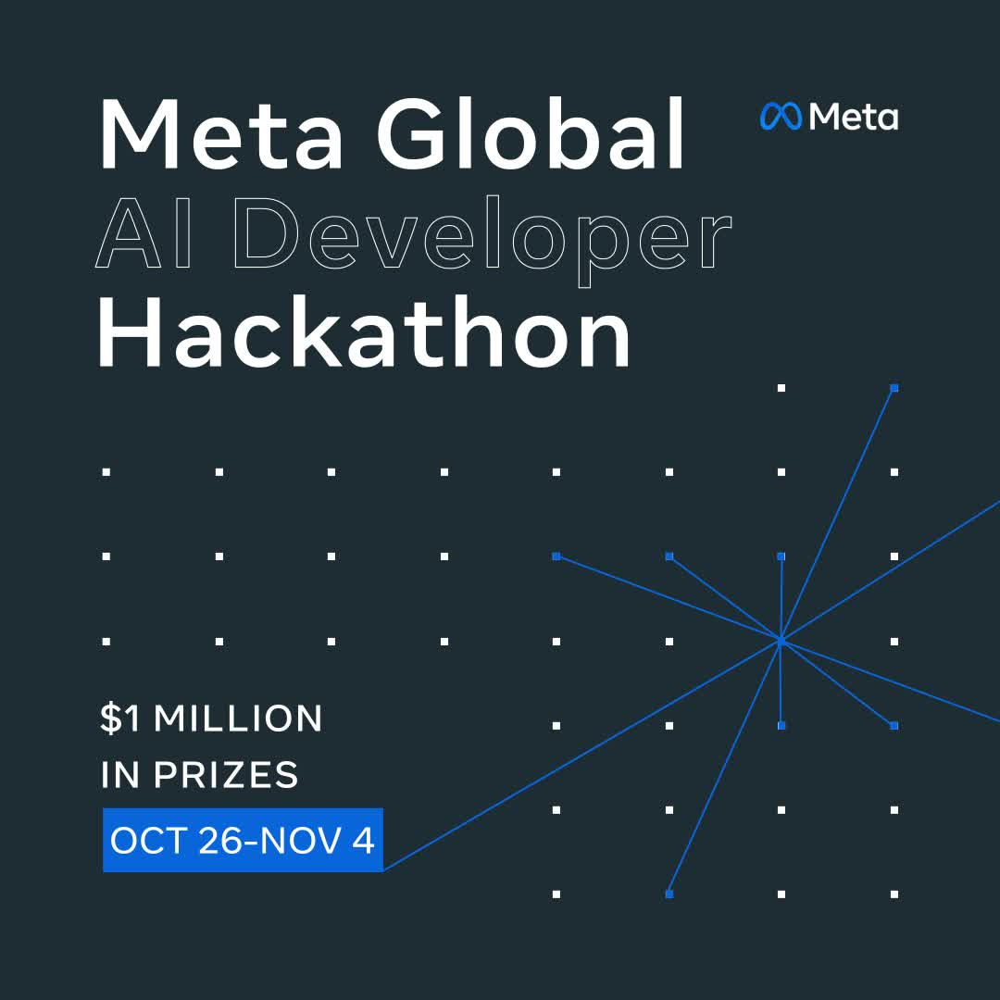
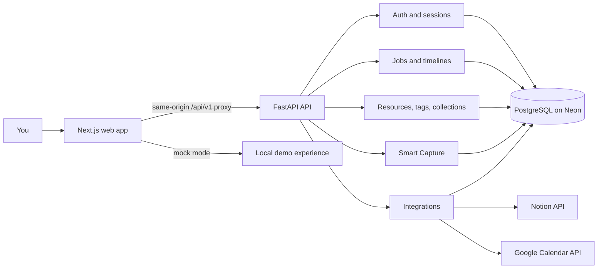

<p align="center">
  
</p>

<h1 align="center">Nuse</h1>
<p align="center"><strong>A quieter place to move your career forward.</strong><br>
Save opportunities. Keep useful finds. Make the next step visible.</p>

<p align="center">
  
</p>
<p align="center"><sub>Built for the Meta Global AI Developer Hackathon. Selected to participate from a field of 20,000 people.</sub></p>

Nuse brings job tracking and a personal resource library into one considered
workspace. Smart Capture turns a link or pasted text into an editable draft;
you review every field before anything is saved.

## What it does

- Track job opportunities from saved through offer, with follow-ups and a
  chronological timeline.
- Keep courses, tools, articles, research, and other finds searchable and
  organized.
- Capture a URL or text, inspect extracted fields and their provenance, then
  choose what to save.
- Connect a Notion database for resource export and Google Calendar for
  scheduled job events.
- Use a responsive interface designed around a calm desk and an expressive
  capture card—not a wall of dashboard widgets.

## How it fits together



The web app is deployed separately from the API. Its same-origin proxy keeps
session cookies first-party; the API owns validation, authorization, and
database access. Personal records are scoped to their owner. Integration
credentials are encrypted at rest.

## Repository map

```text
apps/
  web/                 Next.js app, UI, and typed API client
  api/                 FastAPI app, modules, Alembic migrations, and tests
contracts/
  openapi.json         Committed API schema
docs/
  BLUEPRINT.md         Product and technical brief
  DEPLOYMENT.md        Local setup, Vercel, Render, Neon, and operations
  api/                 Human-readable API contracts
  architecture/        Architecture and security notes
  design/              Design plan, decisions, and review notes
hackathon.jpg          Meta Global AI Developer Hackathon brochure
render.yaml            Render API service definition
```

## Run it locally

For live development, use Node.js 20.9 or newer with pnpm, Python 3.12 or
newer with `uv`, and a PostgreSQL database.

The web app starts in **mock mode** and does not need a database:

```powershell
cd apps\web
pnpm install
pnpm dev
```

Open [http://localhost:3000](http://localhost:3000).

For the live API, use a PostgreSQL database (the deployment guide uses Neon),
then in a second PowerShell window:

```powershell
Copy-Item apps\api\.env.example apps\api\.env
```

Set `DATABASE_URL`, `SESSION_SECRET`, `PIN_PEPPER`, and
`INTEGRATION_ENCRYPTION_KEY` in `apps\api\.env`. Keep those values private.
Then run:

```powershell
cd apps\api
uv sync
uv run alembic upgrade head
uv run fastapi dev src\hub\main.py
```

Set `NEXT_PUBLIC_API_MODE=live` in `apps\web\.env.local` (copy it from
`.env.example`) and run the web app. The local Next.js proxy targets
`http://127.0.0.1:8000` by default.

The first account can sign up while the database is empty. Signup closes
automatically after that account is created; login remains available.

## Checks

```powershell
cd apps\api
uv run ruff check src tests
uv run pytest

cd ..\web
pnpm lint
pnpm build
```

The database-backed authorization tests need a PostgreSQL database configured
for the API tests. Frontend checks run independently.

## Deployment and project status

The planned hosting stack is **Vercel (web) + Render (API) + Neon PostgreSQL
(Singapore)**. Setup, environment variables, first-owner signup, migrations,
provider credentials, rollback, and backup/restore steps are in
[docs/DEPLOYMENT.md](docs/DEPLOYMENT.md).

The application code and automated checks are in place, but the project has
not yet been deployed or verified against live Notion and Google credentials.
Production setup still requires provider configuration, a real deployment
smoke test, and a database backup/restore drill.
